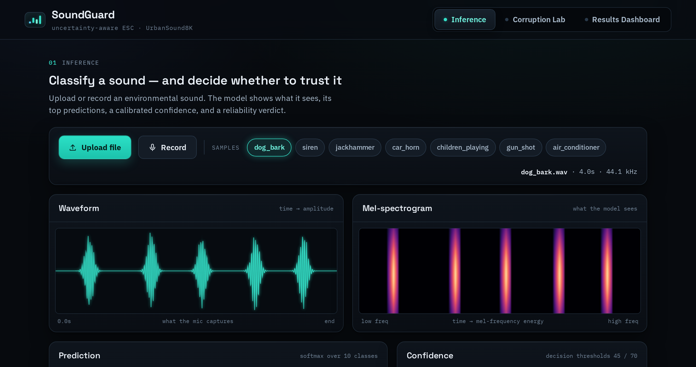
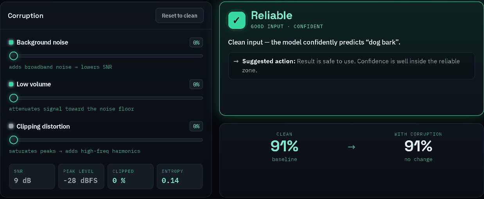
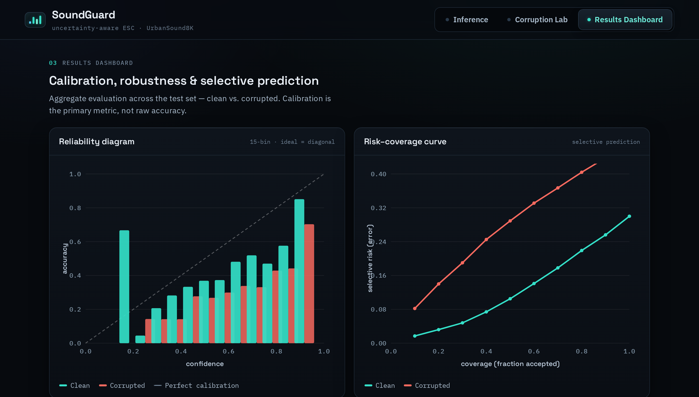

# SoundGuard

Urban sound classification that also decides whether to trust its own answer.

A recording is classified into one of the ten UrbanSound8K categories, and the system then returns a
reliability verdict — `reliable`, `uncertain` or `reject` — so that an answer it cannot stand behind is
declined rather than reported. The accuracy is the denominator of that argument, not the result.



## Quickstart

```bash
pip install -r requirements.txt
uvicorn app:app --port 8000
# open http://localhost:8000
```

The seven demo chips run the real model on real UrbanSound8K clips in `samples/`. There is no mock path:
if a dependency, the checkpoint or a clip is missing, the endpoint returns an explicit error. A fabricated
answer is indistinguishable from a real one to the caller, and that was the cause of a real incident.

## What the system is for

Raise the background noise on a clean recording and watch the verdict walk from `reliable` to `reject`.
The model keeps answering; the point is that the system stops reporting the answer.



At 0 percent noise the recording is classified as dog bark with 91 percent confidence and the answer is
accepted. At 100 percent noise the estimated signal-to-noise ratio is 2 dB, confidence has fallen to 68
percent, and the answer is declined.

## The numbers

Measured out of fold over the ten official folds, last epoch — the honest figure, not the best epoch
selected on the evaluation fold:

| | clean | corrupted |
|---|---|---|
| accuracy | 70.0 % | 52.7 % |
| expected calibration error | 0.186 | 0.323 |
| negative log-likelihood | 1.466 | 2.860 |
| Brier score | 0.476 | 0.759 |

The corrupted condition is a mixture: each recording receives one randomly chosen corruption at one
randomly chosen severity.

> Do not measure accuracy by running the served model on UrbanSound8K clips. `checkpoints/mlp_prod.pth`
> is trained on all of UrbanSound8K, so those clips are training data and it scores about 100 percent on
> them. The honest number is the out-of-fold one above, computed from `rerun_results/mlp_fold*.pt`.



## How it works

```
audio -> resample 16 kHz -> crop 4 s -> log-mel (64 bands) -> 1->3 channels
      -> min-max [0,1] -> ImageNet normalisation -> frozen ResNet-18 -> 512-d
      -> MLP head -> softmax -> confidence
                                   +
                 input quality (SNR proxy, level, clipping) -> reliability verdict
```

The backbone is frozen: only the head is trained. That choice is the principal reason the accuracy is
what it is, and it is declared rather than hidden.

## The paper

This system is the subject of *A Measurement Error in an Urban Sound Rejection Policy*, to appear at
SOICT 2026 (Springer CCIS). The paper audits the reliability verdict served here and finds that the
quantity the policy calls a signal-to-noise ratio is, by an algebraic identity, the inter-decile range
of frame energy in decibels: it measures how widely the energy of a recording is spread, not how much
noise it carries. Removing that axis from the accept decision lowers the selective risk at a matched
coverage, and the confidence threshold it leaves behind should be anchored to a coverage target rather
than to an absolute value.

`experiments/` reproduces every number in the paper and maps each one to the script that produces it.
See [experiments/README.md](experiments/README.md). Note that the paper measures a linear probe at
70.6 %, not the MLP head at 70.0 % that the app serves; the two must not be mixed.

## Layout

| path | what it is |
|---|---|
| `app.py` | FastAPI: `/api/predict`, `/api/predict/upload`, `/api/dashboard`, `/api/health`, static mount |
| `predictor.py`, `features.py`, `heads.py` | serving pipeline: features, head, prediction |
| `corruption.py` | the ten corruptions and the input-quality heuristics |
| `rejection.py` | the three-state reliability verdict and its thresholds |
| `metrics.py`, `eval.py` | calibration and selective-prediction metrics; builds `results/dashboard.json` |
| `static/` | the web interface |
| `pipeline.py`, `sg/`, `summarise_*.py` | the research pipeline (not needed to serve the app) |
| `experiments/` | the scripts that reproduce the paper, one per claim |

## Tests

644 tests: 640 pass, 3 skip where an artifact is absent, and 1 expected failure that documents the
training-data caveat above. The suites are complementary, not duplicates:

| suite | covers |
|---|---|
| `tests_fe/` | the browser: rendering, interaction, injection, accessibility, responsiveness, races |
| `tests_be/` | the endpoints: contract, validation, malformed and adversarial input, concurrency |
| `test_app.py` | the endpoint contract, end to end |
| `tests_ai/` | the science: metric formulas, train/serve parity, model quality, reproducibility |
| `tests_sys/` | the system: deployment, end-to-end flows, cross-layer number consistency, performance, resilience |
| `test_metrics.py` | metrics and eval |

```bash
pytest -q                     # everything (tests_fe needs: playwright install chromium)
pytest tests_sys -q           # one suite
```

Each suite keeps its helpers in a uniquely named module (`helpers_be.py`, `helpers_sys.py`, …) and its
test files have unique basenames, so the whole tree collects in one pytest run.

These tests load the model and are not light: a full run takes about four minutes and saturates the CPU.
Run them on a machine with room to spare rather than on a laptop you are using for something else.

## Data and attribution

The seven clips in `samples/` are taken from UrbanSound8K and are redistributed here only so that the
demo runs without a download. They remain under the licence of that dataset, Creative Commons
Attribution-NonCommercial 4.0, and so does any use of them:

> J. Salamon, C. Jacoby and J. P. Bello. A dataset and taxonomy for urban sound research.
> 22nd ACM International Conference on Multimedia, Orlando, 2014.
> https://urbansounddataset.weebly.com/urbansound8k.html

The full dataset is not included. `pipeline.py` expects it to be downloaded separately from the address
above. The frozen backbone is torchvision's ResNet-18 with its ImageNet weights.

## Notes for whoever comes next

- `results/dashboard.json` is generated by `eval.py` from the fold logits. The web dashboard, the file and
  `metrics.py` must agree; `tests_sys/test_l3_consistency.py` asserts that they do.
- The input-quality gate is a heuristic. `estimate_snr_db` measures temporal energy contrast, not absolute
  signal-to-noise ratio, so its thresholds are calibrated to the scale that real recordings actually
  produce (`rejection.py`). It is used only for the live verdict, never for a reported metric.
- Recordings made in the browser are converted to WAV client-side, because the server's decoder does not
  read the WebM that browsers produce.
- `features.py` crops to the 4 second window before resampling, not after. The features are identical
  either way, but the cost then stops scaling with the length of the upload.
- `requirements.txt` does not pin versions. Two machines can therefore differ at the edges: for example
  `python-multipart` 0.0.20 accepts a 10 000-character filename while 0.0.32 rejects it with a 400.
